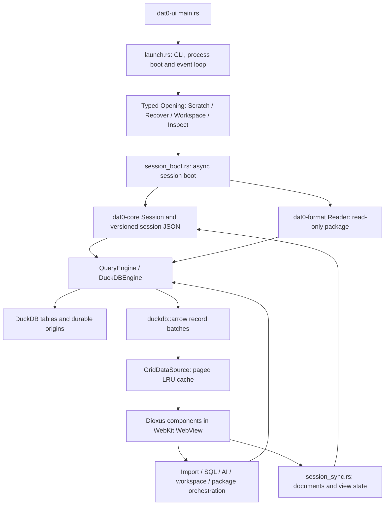

# Architecture

[Documentation index](README.md) · [Contributor setup and checks](../CONTRIBUTING.md)

The workspace uses Rust 2024 and the pinned Rust 1.97.0 toolchain. UI orchestration belongs in the desktop crate; reusable state and services belong in toolkit-free core; SQL execution and package wire contracts have separate boundaries.

## Workspace crates

| Member | Responsibility |
|---|---|
| [`dat0-ui`](../crates/dat0-ui/src/lib.rs) | Dioxus desktop shell, WebView assets, interaction routing and orchestration of imports, SQL, AI, workspaces and packages |
| [`dat0-core`](../crates/dat0-core/src/lib.rs) | Toolkit-free sessions, views, queries, actions, platform paths and services such as settings, connections, AI, updates and telemetry |
| [`dat0-engine`](../crates/dat0-engine/src/lib.rs) | `QueryEngine` interface, native `DuckDBEngine`, paged execution, table registration and durable origins |
| [`dat0-format`](../crates/dat0-format/src/lib.rs) | Versioned package model, `Reader`/`Writer`, checksums, diff and replay |
| [`dat0-fixtures`](../crates/dat0-fixtures/src/lib.rs) | Reproducible synthetic data fixtures for development and tests |
| [`dat0-i18n`](../crates/dat0-i18n/src/lib.rs) | Catalog-backed localized strings |
| [`dat0-keychain`](../crates/dat0-keychain/src/lib.rs) | OS-backed credential storage and fallback behavior |
| [`xtask`](../xtask/src/main.rs) | Existing packaging, release preflight, signing, update-manifest verification and performance commands |

## Startup and data flow

The binary's [`main.rs`](../crates/dat0-ui/src/main.rs) delegates to [`launch.rs`](../crates/dat0-ui/src/launch.rs). CLI help/version and package commands are handled before desktop launch. The launcher establishes process services, single-instance forwarding and the Tokio context around the desktop event loop.

[`Opening`](../crates/dat0-core/src/events.rs) describes what a window actually opens:

- **Scratch** creates a fresh session and queues its file paths.
- **Recover** reopens a selected scratch directory left by a closed or crashed window.
- **Workspace** opens the selected folder's mutable state, including workspace locking.
- **Inspect** opens a sealed package read-only.

[`session_boot.rs`](../crates/dat0-ui/src/session_boot.rs) builds the selected session asynchronously, publishes a ready or failed session slot, and restores the appropriate tabs. It does not turn every opening into a fresh scratch session. [`session_sync.rs`](../crates/dat0-ui/src/session_sync.rs) bridges session persistence and component state.

The [`QueryEngine`](../crates/dat0-engine/src/trait_def.rs) boundary is implemented by [`DuckDBEngine`](../crates/dat0-engine/src/duckdb_engine.rs). The type chain is **DuckDB → `duckdb::arrow` → engine/core → UI**: use the Arrow re-export from the pinned DuckDB dependency, not a separately versioned Arrow dependency. [`GridDataSource`](../crates/dat0-core/src/grid/data_source.rs) caches paged Arrow record batches; Dioxus grid components render visible cells into the WebView rather than sending an entire table to the DOM.

## Desktop orchestration entry points

| Flow | Source |
|---|---|
| Import wizard and file registration | [`import_flow.rs`](../crates/dat0-ui/src/import_flow.rs) |
| Read-only SQLite attachment | [`sqlite_open.rs`](../crates/dat0-ui/src/sqlite_open.rs) |
| SQL execution, cancellation and result views | [`components/sql_console/host.rs`](../crates/dat0-ui/src/components/sql_console/host.rs) |
| AI panel and SQL assistance | [`ai_flow.rs`](../crates/dat0-ui/src/ai_flow.rs) |
| Workspace opening and promotion/save | [`workspace_open.rs`](../crates/dat0-ui/src/workspace_open.rs), [`workspace_save.rs`](../crates/dat0-ui/src/workspace_save.rs) |
| Package inspection and export | [`package_open.rs`](../crates/dat0-ui/src/package_open.rs), [`package_export.rs`](../crates/dat0-ui/src/package_export.rs) |
| Package unpack and replay | [`package_unpack.rs`](../crates/dat0-ui/src/package_unpack.rs), [`package_replay.rs`](../crates/dat0-ui/src/package_replay.rs) |

SQL documents, history and saved queries can persist; SQL-result grid tabs are transient views and need rerunning after recovery. Running a query again replaces that query tab's temporary result view. See [workspaces](workspaces.md) and [recovery](live-data-recovery.md) for the user-facing lifecycle.

## Persistence and compatibility

A **workspace** is a mutable folder whose `.dat0/` holds its DuckDB database and session metadata. A **package** is an immutable `.dat0` ZIP artifact carrying data, recorded recipes/lineage, view overlays, saved queries and charts. It is not a complete copy of every UI draft, preference or history. See [packages](dat0-packages.md), the normative [format contract](dat0-format-v1.md) and [manifest schema](schemas/dat0-manifest-v1.schema.json).

Tables and their origins live in DuckDB; tabs, transforms and SQL documents live in session JSON. Engine [migration 2](../crates/dat0-engine/src/migrations.rs) creates `__dat0_meta_origins`; [`origins.rs`](../crates/dat0-engine/src/origins.rs) writes and reloads source provenance and file read options. Restarting an engine therefore does not inherently discard export lineage or import dialect options. Older tables without stored origin/read metadata retain the narrower fallback caveat described in the package and refresh guides.

Session compatibility is explicit: [`session/mod.rs`](../crates/dat0-core/src/session/mod.rs) defines the schema version and additive defaults; [`session/migrate.rs`](../crates/dat0-core/src/session/migrate.rs) handles older schemas and eager write-back. Newer versions and unknown transform kinds are rejected rather than silently dropping state; preserved extra fields support round trips. Persistence changes must consider versioning, migration, missing-field defaults and existing round-trip compatibility checks. Package changes must additionally preserve tagged wire types, type fidelity, checksums and replay contracts. Follow the change-specific checks in [CONTRIBUTING](../CONTRIBUTING.md) and [CI guidance](ci.md).

## Paths, assets and network boundaries

Platform path resolution lives in [`platform/macos.rs`](../crates/dat0-core/src/platform/macos.rs) and [`platform/linux.rs`](../crates/dat0-core/src/platform/linux.rs). `DAT0_CONFIG_DIR` overrides configuration and `DAT0_CACHE_DIR` overrides cache/log storage. macOS app data shares the config directory; Linux app data uses `$XDG_DATA_HOME/dat0`. These variables do not isolate OS credentials or the shared `~/.duckdb/extensions` cache and do not create a security sandbox. The contribution guide supplies a scratch-profile recipe.

Credentials normally use OS secret stores through `dat0-keychain`, with existing in-memory fallback behavior. Settings are separate from secret material. [`boot.rs`](../crates/dat0-core/src/boot.rs) initializes settings, recents, local logs and opt-in telemetry, and can acquire the SQLite extension before windows open.

[`protocol.rs`](../crates/dat0-ui/src/protocol.rs) serves CSS, icons, fonts and the checked-in CodeMirror bundle through a custom asset protocol. `rust-embed` embeds assets in release builds; ordinary debug builds use its filesystem-backed asset behavior. There is no required `dx` or Node step for an ordinary Rust checkout; Node/npm are only needed to rebuild CodeMirror.

Local file workflows do not automatically upload tables, but local-first is not a promise of no networking. Update checks, extension acquisition, selected remote samples and chosen MotherDuck/AI services have distinct traffic. Desktop AI request builders in [`components/ai.rs`](../crates/dat0-ui/src/components/ai.rs) send prompts/Explain SQL and schema with `sample_rows: None`; user text itself may contain sensitive information. The canonical boundaries, endpoint caveats and crash-specific redaction are documented in [privacy](privacy.md), [AI providers](ai-providers.md) and the [privacy review process](privacy-review-process.md). Report vulnerabilities or unintended data disclosure through [SECURITY.md](../SECURITY.md).
